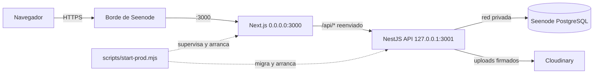
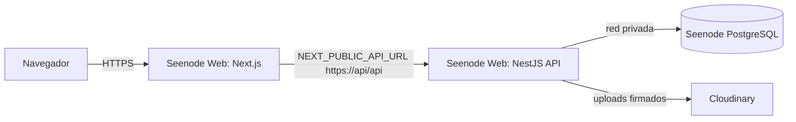

# Despliegue en Seenode (paso a paso)

> Para operar un despliegue (orden, controles, prueba de humo, reversión y diagnóstico de
> incidentes) usa el [runbook de despliegue](./runbook-despliegue.md). Este documento detalla
> la configuración del servicio en el panel de Seenode. La decisión de plataforma y la validación
> previa en el período de prueba están en [`despliegue/`](./despliegue/DECISION-DESPLIEGUE.md).

Arquitectura objetivo: **un solo Web Service** (API NestJS y frontend Next.js en el mismo
contenedor) + un PostgreSQL administrado, todo en Seenode, con Cloudinary como servicio
complementario para imágenes. El esquema de dos Web Services queda como alternativa en la
[sección 6](#6-alternativa-dos-web-services).



Notas de plataforma (importantes):
- Seenode soporta monorepos con el campo **Root Directory**; aquí se deja en la **raíz del
  repositorio**, que trae un `package.json` mínimo con los scripts `build` y `start` (sin dependencias).
- Seenode **no inyecta la variable `PORT`**: el puerto se fija en el campo "Port" del panel
  (3000) y Next escucha en `0.0.0.0` en ese puerto. La API solo escucha en loopback (`127.0.0.1:3001`)
  y no es alcanzable desde fuera.
- HTTPS y URL pública salen automáticamente del Web Service. El navegador usa un solo origen:
  `NEXT_PUBLIC_API_URL=/api`.
- Valores que dependen del plan Basic (0,5 GB de RAM, 0,2 CPU, 750 MB de disco, tiempo de build,
  saltos del proxy de Seenode) están **pendientes de medir en la fase 1** del período de prueba
  (`despliegue/RUNBOOK-DESPLIEGUE.md`); hasta entonces valen los valores por omisión del código.

## 0. Prerrequisitos

- Repo en GitHub: `Professional-and-Personal-Branding/reto-constancia-mvp` (ya está).
- Cuenta de Cloudinary con `cloud name`, `api key`, `api secret`.
- Cuenta en Seenode (https://seenode.com), GitHub autorizado.
- Una versión etiquetada que ya incluya el servicio único (`scripts/start-prod.mjs`; objetivo: 1.16.0).

## 1. Base de datos (PostgreSQL administrado)

1. Panel de Seenode → **Databases** → **Create database**.
2. Tipo **PostgreSQL**, versión **16** (pendiente de confirmar en la fase 1) y tier Basic (20 conexiones).
3. Al crearse, copia la **connection string** (usa la de **red privada** para la aplicación).
   Será el valor de `DATABASE_URL`. Asegúrate de que termine en
   `?schema=public&connection_limit=5`: el segundo parámetro limita el pool de Prisma para no agotar
   las 20 conexiones del plan.

## 2. Web Service único (API + web)

1. **New** → **Web Service** → conecta el repo y elige la rama **`main`**.
2. **Root Directory**: la raíz del repositorio (déjalo vacío).
3. **Build Command**:
   ```
   npm run build
   ```
   Instala (`npm ci`), compila la API y después la web, en secuencia y con el heap acotado
   (`BUILD_MAX_OLD_SPACE_MB`, 400 por omisión), y elimina las dependencias de desarrollo.
   Imprime el tamaño de `backend/` y `frontend/` (límite de disco del plan: 750 MB).
4. **Start Command** (el supervisor: migra, arranca la API, espera su `/api/health`, arranca la web y
   termina el contenedor si cualquiera de los dos procesos muere):
   ```
   npm start
   ```
5. **Port**: `3000`.
6. **Health check**: `/api/health` (atraviesa la web y la API: falla si cualquiera cae; no usa la base).
7. **Environment Variables**:
   - `DATABASE_URL` = (connection string de red privada del paso 1, con `connection_limit=5`)
   - `JWT_SECRET` = (secreto fuerte; ver abajo)
   - `JWT_REFRESH_SECRET` = (otro secreto fuerte, distinto)
   - `JWT_ACCESS_EXPIRES_IN` = `15m`
   - `JWT_REFRESH_EXPIRES_IN` = `7d`
   - `API_PREFIX` = `api`
   - `PORT` = `3000`
   - `NEXT_PUBLIC_API_URL` = `/api` (**variable de BUILD**: se incrusta al compilar; relativa porque
     la web y la API comparten origen)
   - `CORS_ORIGIN` = (URL pública del servicio, sin slash final; se completa tras crearlo y se redespliega)
   - `CLOUDINARY_CLOUD_NAME`, `CLOUDINARY_API_KEY`, `CLOUDINARY_API_SECRET`
   - `CLOUDINARY_FOLDER` = `reto-constancia`
   - `NODE_ENV` = `production` (**obligatorio**: activa las protecciones de producción)
   - `TRUST_PROXY` = `1` (el borde de Seenode es el salto de confianza; es el valor por omisión del
     supervisor, así que puedes omitirla; el valor definitivo se confirma en la fase 1)
   - `SEED_ADMIN_EMAIL`, `SEED_ADMIN_PASSWORD`, `SEED_ADMIN_NAME` (para el primer seed)
   - Opcionales de ajuste: `API_PORT` (3001), `API_MAX_OLD_SPACE_MB` (224), `WEB_MAX_OLD_SPACE_MB`
     (160), `BUILD_MAX_OLD_SPACE_MB` (400). `API_PORT` debe ser el mismo al compilar y al arrancar.
   - Opcionales para importar desde Google Sheets: `GOOGLE_SERVICE_ACCOUNT_EMAIL`,
     `GOOGLE_PRIVATE_KEY`, `GOOGLE_SHEETS_DEFAULT_RANGE` (ver `docs/import-template.md`)
   - No definas `HOST` ni `SWAGGER_ENABLED`: el supervisor ya limita la API a loopback y Swagger queda
     apagado en producción.

   > **Sin `CLOUDINARY_*` la subida de archivos queda deshabilitada** en producción: el
   > simulador local no se activa (guardaría archivos en un disco efímero y expondría un
   > endpoint de subida). Sin `CORS_ORIGIN`, la API no acepta llamadas desde el navegador.
8. Crea el servicio. Anota su URL pública (p. ej. `https://reto-app.seenode.app`).
9. Verifica salud: abre `https://<servicio>/api/health` (debe responder `{"status":"ok"}`)
   y `https://<servicio>/api/health/db` (debe responder `db: "up"`). Además, desde tu máquina:
   `node scripts/single-service-smoke.mjs https://<servicio>` (ver el runbook §1.6 sobre sus casos de
   límite de login).

## 3. Cerrar el círculo (CORS) y primer seed

1. Vuelve al Web Service → Environment Variables.
2. Pon `CORS_ORIGIN` = URL pública del servicio (sin slash final), redeploy.
3. Primer seed del admin (solo una vez): abre una shell del servicio y corre:
   ```
   cd backend && npx prisma db seed
   ```
   Con `NODE_ENV=production` el seed **solo crea el admin** de `SEED_ADMIN_*` y falla si
   `SEED_ADMIN_PASSWORD` no está definido. Los datos de demo (participantes con contraseña
   conocida, reto y actividades de mayo) no se siembran salvo que pongas `SEED_DEMO=true`,
   cosa que no deberías hacer en producción. Cambia el password del admin tras el primer login.

## 4. Checklist previo a producción

Antes de anunciar el despliegue, confirma cada punto:

| # | Verificación | Cómo |
|---|---|---|
| 1 | `NODE_ENV=production` en el servicio | Variables del servicio |
| 2 | `JWT_SECRET` y `JWT_REFRESH_SECRET` distintos y generados al azar | Ver "Generar secretos" |
| 3 | `CORS_ORIGIN` = URL exacta del servicio, sin slash final | Abrir la app y comprobar que no hay errores de CORS en la consola |
| 4 | `CLOUDINARY_*` configurado | Subir una foto desde la app; si falta, la subida queda deshabilitada |
| 5 | `SEED_ADMIN_PASSWORD` fuerte y cambiado tras el primer login | Login del admin |
| 6 | Sin usuarios de demo en la base | `SELECT email FROM "User"` no debe traer `ana@reto.local` y compañía |
| 7 | Salud y base | `GET /api/health` y `GET /api/health/db` responden `ok` |
| 8 | Migraciones aplicadas y `connection_limit` presente | Los logs del arranque muestran `migrate deploy` sin pendientes y no traen la advertencia de `connection_limit` |
| 9 | Batería automatizada en verde en el commit desplegado | `node scripts/run-tests.mjs` (ver `docs/testing.md`) |
| 10 | Recorridos manuales de la Parte 2 de `docs/test-cases.md` | Al menos los recorridos 1, 3, 4 y 5 contra el entorno desplegado |
| 11 | Estado de dependencias revisado | `npm audit --omit=dev` en ambos proyectos (ver `docs/security-owasp.md`) |
| 12 | Cabeceras de seguridad y límite de login por cliente | `curl -sI https://<servicio>/` y la comprobación de dos redes de la fase 5 de `despliegue/RUNBOOK-DESPLIEGUE.md` |

## 5. Verificación end-to-end

- Entra a la URL del servicio, login con el admin.
- Crea un reto, inscribe participantes, sube/valida una actividad.
- Prueba la importación masiva en `Dashboard → Importar` (ver `docs/import-template.md`).

## 6. Alternativa: dos Web Services

Esquema anterior, **no es el camino por omisión** (12 USD por mes en Seenode contra 8 del servicio
único). Un Web Service para la API (Root Directory `backend`) y otro para la web (Root Directory
`frontend`) con una base. El mismo commit sirve para ambos esquemas.



**API (Web Service `backend`):**

1. **New** → **Web Service**, rama **`main`**, **Root Directory**: `backend`.
2. **Build Command**: `npm install && npx prisma generate && npm run build`
3. **Start Command** (migra y arranca): `npx prisma migrate deploy && exec node dist/main.js`
4. **Port**: `3000` (el backend escucha en `PORT` con default 3000 y enlaza `0.0.0.0`).
5. Variables: las de la sección 2, sin `NEXT_PUBLIC_API_URL`, `API_PORT` ni las de memoria; `PORT` = `3000`;
   `CORS_ORIGIN` = URL pública de la **web** (se completa tras crearla). Anota la URL pública de la API
   (p. ej. `https://reto-api.seenode.app`) y verifica `https://<api>/api/health` y `/api/health/db`.

**Web (Web Service `frontend`):**

1. **New** → **Web Service**, misma rama, **Root Directory**: `frontend`.
2. **Build Command**: `npm install && npm run build`
3. **Start Command** (fija el puerto explícitamente): `npx next start -p 3000`
4. **Port**: `3000`. Variable de build: `NEXT_PUBLIC_API_URL` = `https://<api>/api`
   (sin `API_INTERNAL_URL`: no hay reenvío).

**Cerrar el círculo:** en la API, `CORS_ORIGIN` = URL pública de la web (sin slash final) y redeploy; el
primer seed se corre desde la shell del servicio API con `npx prisma db seed` (sin `cd backend`).
Despliega la API primero y la web después; para volver atrás, redespliega ambos.

## Generar secretos fuertes

```bash
# Linux/macOS
openssl rand -base64 48
# Cualquier máquina con Node
node -e "console.log(require('crypto').randomBytes(48).toString('base64'))"
```

Genera uno para `JWT_SECRET` y otro distinto para `JWT_REFRESH_SECRET`.

## Notas de mantenimiento

- Cada push a `main` puede redeployar (Seenode redeploya al recibir push en la rama).
- Las migraciones se aplican solas en el arranque (el supervisor corre `prisma migrate deploy` antes de
  la API y no arranca nada si falla).
- Si cambias el esquema: crea la migración localmente
  (`npx prisma migrate dev --name <desc>`), súbela vía PR; al desplegar `main`
  se aplicará con `migrate deploy`.
- Si cambias `NEXT_PUBLIC_API_URL`, `API_INTERNAL_URL` o `API_PORT`, hay que volver a compilar: el
  redeploy ya lo hace.
- Mantén `DATABASE_URL` apuntando a la red privada para menor latencia y mayor seguridad.
